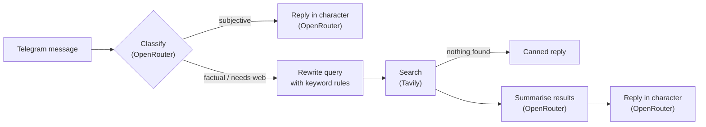

# FURIOSO Bot

A Telegram bot that talks like the most passionate FURIA Esports fan and answers questions about the teams with up-to-date info from the web.

## Overview

FURIOSO was built in April–May 2025 for a FURIA Esports technical challenge: create a conversational experience for the organization's fans. The bot speaks **Brazilian Portuguese** in an informal, fan-chat tone, and covers FURIA's CS2, Valorant, League of Legends and Rainbow Six teams.

Opinion questions ("Qual seu jogador favorito?") get an in-character answer. Questions about facts that change (lineups, coaches, signings, next matches) trigger a web search and are answered from what the search returns.

## Features

| Command | What it does |
| --- | --- |
| `/start` | Greets the user by name and lists the commands |
| `/menu` | Example questions, e.g. "Quem tá na line do CS2?", "Quem é o técnico do LoL?" |
| `/agenda` | Searches the web for FURIA's upcoming matches and extracts dates, times and opponents |
| `/resenha` | Sends a random line of fan banter |
| any text | Answers the question in character (see below) |

While it works on an answer, the bot posts a short "loading" message and deletes it once the reply is sent.

## How it works



1. **Classify.** An LLM call (`classificador` prompt) labels the message as `subjetiva`, `factual` or `precisa_web`, plus the game it refers to (logged only).
2. **Subjective questions** go straight to the persona prompt (`furioso_personagem`), which answers like a fan.
3. **Factual / web questions** are rewritten into a search query with simple keyword rules in `agent.py` (game detection, defaulting to CS2, and templates for lineup, coach, signings and next match).
4. **Search.** `search_web.py` calls the Tavily Search API (advanced depth, up to 5 results), sending the trusted sources from `src/base.json`. It uses Tavily's direct answer when it has at least 10 words, otherwise the first result snippet that mentions FURIA.
5. **Summarise, then reply.** One LLM call extracts the relevant facts from the raw content (`interpretador_web`); a second one writes the final answer in character, using only those facts (`furioso_response`).

All prompts live in `src/prompts.json`, so the persona can be tuned without touching the code.

## Tech stack

- Python 3.9+ (`.python-version` pins 3.11)
- [python-telegram-bot](https://github.com/python-telegram-bot/python-telegram-bot) 20.7, long polling
- [OpenRouter](https://openrouter.ai) chat completions API (default model `meta-llama/llama-3-8b-instruct`)
- [Tavily](https://tavily.com) Search API
- `requests`, `python-dotenv`
- [Railway](https://railway.com) for hosting

## Project structure

```
.
├── src/
│   ├── main.py          # Telegram app: commands, message handler, polling
│   ├── agent.py         # Classification, query rewrite, OpenRouter calls, answer pipeline
│   ├── search_web.py    # Tavily search client
│   ├── agenda.py        # /agenda: match search + regex extraction
│   ├── prompts.json     # Prompts (in Portuguese)
│   └── base.json        # Trusted sources sent with every web search
├── .env.example         # Environment variables template
├── .python-version
├── Procfile             # worker: python src/main.py
├── requirements.txt
└── LICENSE
```

## Getting started

Requirements: Python 3.9+, a Telegram account, and API keys for OpenRouter and Tavily.

```bash
git clone https://github.com/thxcabra/Furioso-Bot.git
cd Furioso-Bot

python -m venv .venv
source .venv/bin/activate        # Windows: .venv\Scripts\activate
pip install -r requirements.txt

cp .env.example .env             # then fill in your keys
python src/main.py
```

The bot reads `.env` from the repository root. Send `/start` to your bot on Telegram to try it.

| Variable | Required | Where to get it |
| --- | --- | --- |
| `TELEGRAM_TOKEN` | yes | Create a bot with [@BotFather](https://t.me/BotFather) (`/newbot`) |
| `OPENROUTER_API_KEY` | yes | [openrouter.ai/keys](https://openrouter.ai/keys) |
| `TAVILY_API_KEY` | yes | [app.tavily.com](https://app.tavily.com) |
| `OPENROUTER_MODEL` | no | Any model ID from [openrouter.ai/models](https://openrouter.ai/models). Defaults to `meta-llama/llama-3-8b-instruct` when the variable is not set |

`.env` is git-ignored. Never commit real keys.

## Deploy on Railway

1. Create a Railway project from this GitHub repository.
2. In the service's **Variables** tab, add `TELEGRAM_TOKEN`, `OPENROUTER_API_KEY`, `TAVILY_API_KEY` and, optionally, `OPENROUTER_MODEL`. Set them in the dashboard only; don't commit them.
3. The `Procfile` declares the start command (`worker: python src/main.py`). If Railway doesn't pick it up, set the start command to `python src/main.py` in the service settings.

The bot uses long polling, so it needs no public domain or open port. Run a single instance: Telegram rejects two pollers using the same token.

## Notes and limitations

- The bot only speaks Portuguese, and only about FURIA.
- No conversation memory: every message is handled on its own.
- `src/base.json` is a list of trusted sources (Liquipedia, Leaguepedia, Ubisoft, FURIA's store and social accounts), sent to Tavily to restrict the search. The code sends them as `include_urls`, while Tavily's documented filter is `include_domains`, so the restriction may not be applied.
- Answers are only as good as the search results and the model. The prompts tell the model not to invent names or dates, but that isn't guaranteed.
- `/agenda` finds dates written as `dd/mm/yyyy`, times like `19h30` and opponents after the word "contra", and shows up to three entries. It depends on how the search results are worded.
- API calls are synchronous (`requests`) inside the async handlers, so the bot answers one message at a time. That's fine for a demo but won't scale to heavy traffic.

## License

[MIT](LICENSE)

## Author

**João Cabral** · [GitHub](https://github.com/thxcabra) · [LinkedIn](https://www.linkedin.com/in/joao-cabral-machado/)

---

🇧🇷 **Em português:** o FURIOSO é um bot de Telegram que responde como um torcedor fanático da FURIA Esports, criado para um desafio técnico da FURIA em 2025. Perguntas de opinião recebem resposta direta do personagem; perguntas sobre escalações, técnicos, reforços e jogos passam por uma busca na web (Tavily) e são respondidas com base no que foi encontrado. Comandos: `/start`, `/menu`, `/agenda` e `/resenha`. Para rodar, copie `.env.example` para `.env`, preencha as chaves e execute `python src/main.py`.
